### `$ cat now.md`

- Building an exam and learning platform end to end: REST API, web app, admin dashboard, LMS and a scoring service.
- Shipping cross-platform mobile apps with Flutter.
- Automating delivery for small teams with CI/CD pipelines, deploy scripts and internal tools.

### `$ neofetch`

### `$ git log --graph`

<picture>
  <source media="(prefers-color-scheme: dark)" srcset="https://raw.githubusercontent.com/dotuananhtb/dotuananhtb/output/snake-dark.svg" />
  
</picture>

### `$ ping anh`

